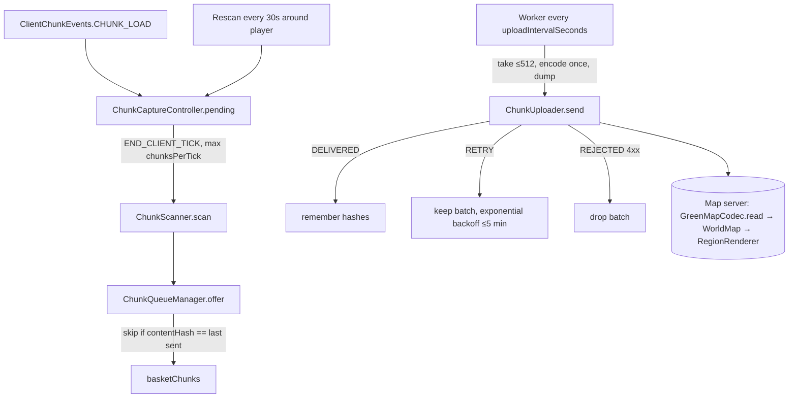

# AGENTS.md — Developer and Agent Guide for GreenMap

GreenMap is a **Fabric mod** for Minecraft **26.1.2**, written in Kotlin. It collects the chunks loaded on a player's client and uploads them to a separate map server, which builds a shared interactive map of the game server.

Key design decision: the mod uploads **semantic data, not pixels**. Each 16×16 column carries the block id, height, water depth, underwater floor block, biome and vanilla `MapColor` id. The map server colours everything with **one canonical palette** built from the vanilla client jar. As a result, players' resource packs, shaders and settings cannot affect the map, and data from different players merges cleanly. The old approach copied Xaero's Minimap ARGB buffers, which depend on each player's resource pack; it was removed for exactly that reason. Do not reintroduce it.

---

## 🛠️ Toolchain and Environment

- **Build**: Gradle (Kotlin DSL) + Fabric Loom 1.17. Use `./gradlew`.
- **Java**: **JDK 25** is required.
  - If `java` is not on `PATH`, use the toolchain Gradle downloaded:
    `export JAVA_HOME=$HOME/.gradle/jdks/eclipse_adoptium-25-amd64-linux.2`.
  - The JVM toolchain is resolved via the foojay plugin in `settings.gradle.kts`.
- **No obfuscation, no mappings**: Minecraft 26.1+ ships with official Mojang names.
  - Reference classes directly, e.g. `level.dimension().identifier()`.
  - Note that `ResourceLocation` is now `Identifier`, and `ChunkPos` is a record with `x()` / `z()` accessors.
- **Checking an API without an IDE**: run `javap` against the Loom-cached jars:
  - `~/.gradle/caches/fabric-loom/minecraftMaven/net/minecraft/minecraft-common-deobf/26.1.2/*.jar`
  - `.../minecraft-clientonly-deobf/26.1.2/*.jar`
  - `./gradlew genSources` gives decompiled sources for an IDE.
- **Versions**: every version lives in `gradle/libs.versions.toml`. Never hardcode versions in build scripts.

### Common tasks

| Command | What it does |
|---|---|
| `./gradlew build` | Builds the mod jar (`build/libs/greenmap-<ver>.jar`) and runs the `:protocol` and `:renderer` tests |
| `./gradlew runClient` | Dev client |
| `./gradlew runExportRegion [-Pregion=x,z] [-Pdimension=minecraft:the_nether]` | Headless dev server: generates one region (random by default) and writes `build/export/r.X.Z.gmap` |
| `./gradlew :renderer:renderExport` | Renders `build/export/*.gmap` to `build/export/png/*.png` |
| `./gradlew :renderer:run --args="--client-jar <jar> --out <dir> [--style textured\|vanilla-map] <gmap or dir>..."` | Renderer CLI. Relative paths resolve against `renderer/` |

Notes on `runExportRegion`:
- It needs `run/export/eula.txt` containing `eula=true`. That is the Minecraft EULA: **only the user may accept it**, so never create the file on their behalf.
- After the export finishes, the server takes about 2–3 minutes to save the world. Run it in the background.

---

## 📂 Project Layout

Gradle modules: the root project (the mod), `:protocol` and `:renderer`.

### Root project (the mod)

Loom `splitEnvironmentSourceSets()` is active. The client source set may use the main set, but **never the other way round**.

- **`src/main/kotlin/org/greamples/greenmap/`** — common code, runs on client and server.
  - `ChunkScanner.kt`: `LevelChunk` → `ChunkSnapshot`. This is the only place that reads the world.
  - `GreenMapDevExport.kt`: `main` entrypoint, a dev tool.
    - Does nothing unless the system property `greenmap.export.out` is set.
    - Generates one region, one row of chunks per server tick. All at once overflows the stack during shutdown.
    - Scans with the same `ChunkScanner`, writes a batch, then halts the server.
- **`src/client/kotlin/org/greamples/greenmap/client/`**
  - `GreenMapClient.kt`: client entrypoint; wires the Fabric events.
  - `GreenMapConfig.kt`: `config/greenmap.json`, loaded with Gson.
    - Gson can put `null` into non-null Kotlin fields, so `sanitized()` restores the defaults.
    - `matchesServer()` matches the exact host or its subdomains.
  - `ChunkCaptureController.kt`: decides which chunks to scan, and when. Runs on the client thread only.
  - `ChunkQueueManager.kt`: the basket of snapshots, deduplication by content hash, and the upload worker (`Timer`).
  - `ChunkUploader.kt`: HTTP POST returning `DELIVERED` / `RETRY` / `REJECTED`, plus an optional dump of batches to disk.
- **`src/main/resources/fabric.mod.json`**
  - `environment: "*"`, so the dev export can run on a server.
  - Entrypoints: `main` (dev export) and `client`.
  - **No mixins and no Xaero dependency.**

### `:protocol`

Pure Kotlin with no Minecraft classes. It ships inside the mod jar via Loom `include(project(":protocol"))` (jar-in-jar).

- `ChunkSnapshot`: column arrays, indexed `z * 16 + x`.
- `SnapshotBatch`: one upload.
- `ChunkSnapshotBuilder`: manages the palettes.
  - Index 0 is always `minecraft:air` / `minecraft:plains`.
  - Ids longer than 256 characters are replaced with `greenmap:unknown`.
- `GreenMapCodec`: the `GMAP` v1 binary format (gzip, big-endian). The decoder runs on the server and treats input as hostile. It enforces these limits; keep them when changing the format:

  | Limit | Value |
  |---|---|
  | Decompressed size | ≤ 16 MB |
  | Chunks per batch | ≤ 1024 |
  | Block palette | ≤ 513 entries |
  | Biome palette | ≤ 257 entries |
  | String length | ≤ 256 |
  | Dimension id | must match a regex |
  | Data after the last chunk | rejected |

### `:renderer`

The reference implementation for the future map server (JVM + Gson, no Minecraft classes).

- `CanonicalPalette`: built from the **vanilla** client jar.
  - Block colour = average colour of the top face of the block model. Model textures can be a string or an object `{"sprite": ...}`.
  - Biome tints come from `data/minecraft/worldgen/biome/*.json` and the colormaps.
  - Unknown (modded) blocks fall back to `MapColor` (`resources/greenmap-mapcolors.txt`).
- `WorldMap`: merges batches. For each chunk the newest snapshot wins, where "newest" uses `min(scannedAt, receivedAt)`: the client's own timestamp is not trusted.
- `RegionRenderer`: renders a 32×32-chunk region as a 512×512 PNG in one of two styles, `TEXTURED` or `VANILLA_MAP`.
- `RenderCli`: CLI entry point. It sanitises output file names, because the dimension name comes from the client.
- The tests read the vanilla jar through the `greenmap.clientJar` system property. If the jar is missing, the palette test passes without checking anything.

### Other

- `docs/sample/`: sample renders and a real upload batch (`r.4.7.gmap`).
- `README.md`: user-facing description, config reference and the HTTP protocol spec. Keep it in sync with the code.

---

## 🏗️ Data Flow

### Scanning rules (`ChunkScanner`)

1. **Starting height.**
   - Normally: from `Heightmap.Types.WORLD_SURFACE`.
   - In dimensions with a ceiling (the Nether): from 5 blocks below the logical top, so the bedrock roof with its random holes is skipped. Then descend through solid blocks to the first air.
2. **Surface.** Descend to the first block whose `MapColor` is not `NONE`, as the vanilla map item does.
3. **Water.** If the surface block has a fluid, count the depth down to the floor block (max 255). Waterlogged blocks count as water.
4. **Empty columns.** Void or not-yet-loaded columns keep `surfaceY = NO_DATA_Y` (-32768) and render as transparent.
5. **Biome.** Taken from `getNoiseBiome` at the surface Y.

### Queue and session rules

- Basket key: `"$dimension:$chunkX:$chunkZ"`. A newer snapshot overwrites an older one.
- On server JOIN, `resetSession()` clears the sent hashes and the basket. The worker then drops the pending retry batch, because the map server cannot tell game servers apart.
- Fields touched only by the worker thread (`pending`, backoff) must stay on that thread. Cross-thread signals use `@Volatile`.
- The `Timer` uses fixed-delay `schedule`, not `scheduleAtFixedRate`, and catches `Throwable`, so one failure cannot kill the upload thread.

---

## ✍️ Coding Conventions and Rules

- **Comments**: write code comments and log messages in **Russian**, matching the existing style.
- **Commits**: AI-made commits are prefixed with `[ai]`, e.g. `[ai] fix: ...`.
- **Do not upload pixels or player-dependent colours.** Any new map data must be semantic (ids, numbers) so the server can render it canonically.
- **Protocol changes**:
  - Bump `GreenMapCodec.VERSION`.
  - Update the format comment in `GreenMapCodec.kt` and the spec in `README.md`.
  - Add a round-trip test in `GreenMapCodecTest`.
- **World access** happens only on the client or server thread. The upload thread works only with immutable `ChunkSnapshot`s and encoded bytes.
- **Kotlin pitfall**: `mutableList += path`, where `path` is a `java.nio.file.Path`, is ambiguous because `Path` is `Iterable<Path>`. Use `add()`.
- **Loom pitfall**: the run-config DSL (`name`, `runDir`, `property`) is deprecated in Loom 1.17 but still works. The warnings are expected.
- **Verification before finishing**:
  - `./gradlew build` must pass, including the tests.
  - For scanner or renderer changes, also run `runExportRegion` + `:renderer:renderExport` (only if `run/export/eula.txt` already exists) and look at the PNG.

---

## 📚 References

- Fabric documentation: https://docs.fabricmc.net/ and the wiki: https://fabricmc.net/wiki/
- Loom: https://fabricmc.net/wiki/documentation:fabric_loom
- Fabric API events used:
  - `ClientChunkEvents`, `ClientTickEvents`, `ClientPlayConnectionEvents` (client);
  - `ServerLifecycleEvents`, `ServerTickEvents` (dev export).
- Vanilla data used by the palette, inside `minecraft-client.jar`:
  - `assets/minecraft/blockstates`, `models/block`, `textures/block`, `textures/colormap`;
  - `data/minecraft/worldgen/biome`.
