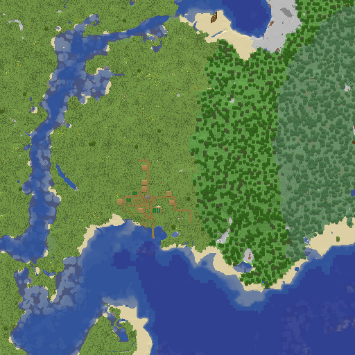

# GreenMap

Fabric-мод (Minecraft 26.1.2) для общей интерактивной карты сервера: мод собирает
чанки, прогруженные у игрока, и отправляет их на отдельный сервер карты.



## Проблема и решение

Раньше мод брал готовые ARGB-пиксели из Xaero's Minimap. Xaero рендерит с учётом
ресурспака игрока (а ещё освещения, режима пещер и т.д.), поэтому при склейке регионов
от разных игроков получается каша: у одного трава зелёная, у другого — бирюзовая.

Теперь мод **не отправляет цвета вообще**. Он читает чанк прямо из мира (`LevelChunk`)
и для каждой из 256 колонок отправляет «смысловые» данные:

| поле | пример | зачем |
|---|---|---|
| верхний блок | `minecraft:grass_block` | что рисовать |
| высота Y | `71` | рельеф/тени |
| глубина жидкости | `4` | вода темнее с глубиной |
| блок дна под водой | `minecraft:sand` | просвечивающее дно |
| биом | `minecraft:plains` | окраска травы/листвы/воды |
| id ванильного `MapColor` | `1` | запасной цвет для модовых блоков |

Цвета выбирает **сервер карты по одной палитре** (`:renderer`), собранной из ванильного
клиентского jar: средний цвет верхней грани модели блока + ванильная биомная окраска.
Ресурспаки, шейдеры и настройки игроков на результат не влияют. Данные от разных игроков
одинаковы, и при склейке для каждого чанка просто берётся самый свежий снимок.

Бонусы: Xaero больше не нужен, а пакеты маленькие: 150–220 байт на чанк в gzip.

## Модули

- **корневой проект (мод)**
  - `src/main/.../ChunkScanner.kt`: `LevelChunk` → `ChunkSnapshot` (общий код клиента и сервера).
  - `src/client/.../ChunkCaptureController.kt`: сканирует загруженные чанки на клиентском
    потоке, не больше `chunksPerTick` за тик; раз в `rescanIntervalSeconds` перепроверяет
    чанки вокруг игрока, чтобы ловить постройки.
  - `src/client/.../ChunkQueueManager.kt`: корзина `измерение:X:Z`, отбрасывает неизменившиеся
    чанки по хэшу содержимого, раз в `uploadIntervalSeconds` отправляет пачку (до 512 чанков).
  - `src/client/.../ChunkUploader.kt`: HTTP POST на `endpoint`, временные ошибки повторяются с нарастающей паузой, 4xx — пачка отбрасывается.
  - `src/main/.../GreenMapDevExport.kt`: инструмент разработчика (см. ниже), без системного
    свойства ничего не делает.
- **`:protocol`**: формат пачки `GMAP` v1 (`GreenMapCodec`), вложен в jar мода (jar-in-jar).
- **`:renderer`**: эталонный рендер для будущего сервера карты: палитра из ванильного jar,
  склейка пачек (`WorldMap`), PNG по регионам 512×512 (`RegionRenderer`), CLI.

## Настройки клиента: `config/greenmap.json`

```json
{
  "enabled": true,
  "serverFilter": "epserv.ru",
  "endpoint": "",
  "token": "",
  "dumpDir": "",
  "uploadIntervalSeconds": 3,
  "rescanIntervalSeconds": 30,
  "chunksPerTick": 8
}
```

- `serverFilter`: сбор работает только на серверах, чей адрес содержит эту строку (пусто — везде, включая одиночную игру).
- `endpoint`: пока пустой, отправки нет. `token` уходит как `Authorization: Bearer …`.
- `dumpDir`: если задан, каждая пачка ещё и сохраняется файлом `*.gmap` (для отладки).

## Протокол для сервера карты

`POST <endpoint>`, `Content-Type: application/x-greenmap-batch`, тело — gzip-поток:

```
"GMAP" u8 version(=1)
utf modVersion, utf minecraftVersion, utf playerName, utf playerUuid, i64 createdAt
i32 chunkCount
chunk*:
  utf dimension, i32 chunkX, i32 chunkZ, i64 scannedAt
  u16 blockPaletteSize, utf*      u16 biomePaletteSize, utf*
  256 × { u16 surfaceBlock, i16 surfaceY, u8 waterDepth, u16 floorBlock, u16 biome, u8 mapColor }
```

Колонки идут в порядке `z * 16 + x`, все числа big-endian, строки в формате `DataOutput.writeUTF`.
`surfaceY == -32768` означает, что данных по колонке нет (void или чанк не догружен).
Ответ 2xx — пачка принята, иначе клиент повторит отправку. Декодер:
`GreenMapCodec.read(...)` из модуля `:protocol`.

## Сборка и проверка

Нужен JDK 25.

```sh
./gradlew build                       # мод: build/libs/greenmap-1.0-SNAPSHOT.jar (+ тесты :protocol и :renderer)
./gradlew runExportRegion             # dev-сервер генерирует случайный регион → build/export/r.X.Z.gmap
./gradlew runExportRegion -Pregion=3,-2 -Pdimension=minecraft:the_nether
./gradlew :renderer:renderExport      # build/export/*.gmap → build/export/png/*.png
```

`runExportRegion` прогоняет регион через тот же `ChunkScanner` и `GreenMapCodec`, что и
клиент, то есть файл `.gmap` — ровно то, что мод отправил бы на сервер. Для dev-сервера нужен
`run/export/eula.txt` с `eula=true`.

Рендер поддерживает два стиля: `textured` (по текстурам, похоже на Xaero, но одинаково для всех)
и `vanilla-map` (только ванильные `MapColor`, как у карты в игре). Примеры лежат в `docs/sample/`,
там же `r.4.7.gmap` — сырая пачка, которую отправил бы мод (1024 чанка, ~220 КБ).
